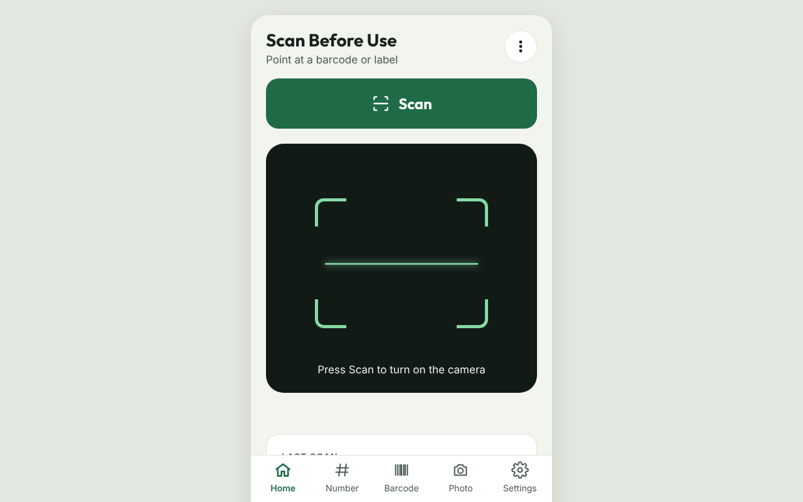
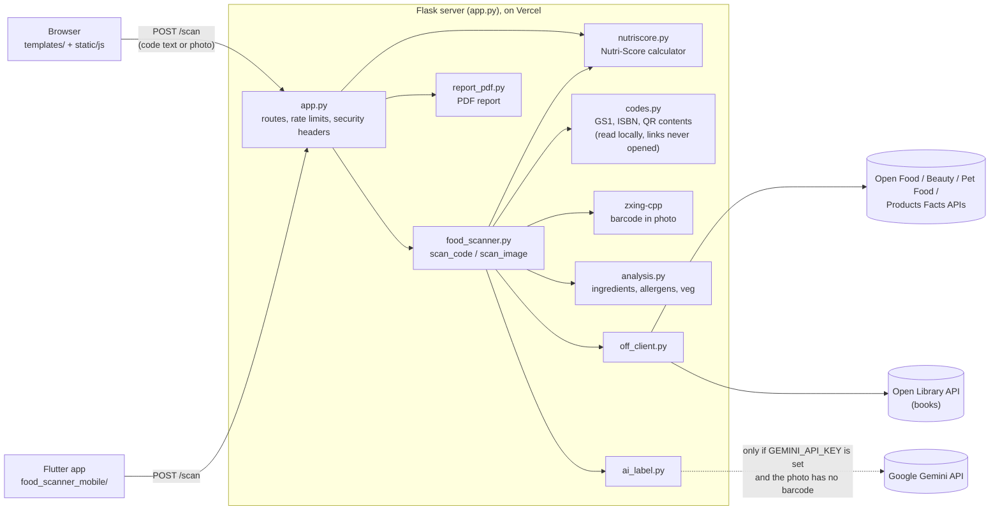

# Scan Before Use

Scan any barcode or QR code and see what it is, before you use it. Works on the web (Flask, deployed on Vercel) and from the Flutter app in `food_scanner_mobile/`.

**Live:** https://fopack-scanner.vercel.app

<p align="center">
  
  <!-- Phone app screenshot: add docs/screenshots/app-scan.png and show it here, e.g.
        -->
</p>

- **Food**: ingredients, possible allergens, vegetarian status (Indian convention: egg is non-veg), Nutri-Score (2023 algorithm) and NOVA group, from [Open Food Facts](https://world.openfoodfacts.org).
- **Other products**: cosmetics, pet food and household items from [Open Beauty Facts](https://world.openbeautyfacts.org), [Open Pet Food Facts](https://world.openpetfoodfacts.org) and [Open Products Facts](https://world.openproductsfacts.org).
- **Books** (ISBN) from [Open Library](https://openlibrary.org).
- **GS1 codes** on medicines and fresh food (GS1-128, GS1 DataMatrix, GS1 Digital Link): product number, expiry date (with a warning when it has passed), batch and serial.
- **Everything else is read from the code itself**: web links, UPI payment requests, Wi-Fi details, contact cards, email, phone, SMS, map locations, calendar events and plain text. Every barcode shows its type, whether the check digit is valid and which GS1 office issued the number.
- **All formats**: QR, Data Matrix, PDF417, Aztec, EAN-13/8, UPC-A/E, Code 128/39/93, ITF, Codabar, GS1 DataBar.
- **Photos** are checked for a barcode on the server (zxing-cpp). If `GEMINI_API_KEY` is set and there's no barcode, Gemini reads the label text. Without a key the site runs with no AI at all.
- **Nothing is faked.** Unknown products, missing ingredients and unconfirmed veg status are shown as such. The server never opens links found in codes.
- **No accounts, no cookies, no server-side storage.** History and saved products live in the visitor's browser.

## How it works



1. The browser or phone app sends the scanned text (or a photo) to `POST /scan`.
2. `food_scanner.py` reads photos with zxing-cpp, then `codes.py` works out what the code is (GTIN/ISBN, GS1 data with expiry and batch, or QR content such as links, UPI and Wi-Fi).
3. Product numbers are looked up through `off_client.py` in the Open Food Facts family of databases, or Open Library for books.
4. For food, `analysis.py` checks ingredients, allergens and veg status, and `nutriscore.py` works out the Nutri-Score.
5. Gemini is used only when a key is set and a photo has no readable barcode. Without a key the site runs with no AI.

## Run locally

```bash
python -m venv venv
source venv/bin/activate              # Windows: venv\Scripts\activate
pip install -r requirements-dev.txt
cp .env.example .env                  # optional: add GEMINI_API_KEY
FLASK_DEBUG=1 python app.py           # http://127.0.0.1:5000
pytest -q                             # run the tests
```

## Deploy on Vercel

1. Import the repo in Vercel (it uses `vercel.json`).
2. In **Project → Settings → Environment Variables**, add what you need from `.env.example`. `GEMINI_API_KEY` is optional; `CONTACT_EMAIL` and `SITE_OWNER` are recommended (shown in the footer and policies).
3. For rate limits that hold across Vercel's instances, add an Upstash Redis URL as `RATELIMIT_STORAGE_URI`.
4. In Google Cloud, set a daily quota on the Gemini API as a hard spending limit.

Docker / Cloud Run: `docker compose up` or `./deploy_gcp.sh` (listens on port 8080).

## API (used by the mobile app)

`POST /scan` with JSON `{"code": "<scanned text>", "format": "QR_CODE"}` (older clients may send `{"barcode": "..."}`) or a multipart `image` file.

Every result has `success`, `kind`, `title`, `code` (`text`, `format`, `facts`), `warning` and `notes`. Then, by `kind`:

- `food`: `dashboard`, `result` and `open_food_facts`, as before
- `product` / `book`: `item` (`title`, `subtitle`, `image_url`, `facts`, `sections`, `database`, `url`)
- `code`: `content` (`type`, `title`, `facts`, `link`) for QR contents, or just `code.facts` and `notes` for barcodes no database knows

`facts` and `sections` are lists of `[label, value]`. Errors return `{success: false, error}` with a 4xx/5xx status.

## Mobile app

`food_scanner_mobile/` is a Flutter app that talks to the live site. GitHub Actions (`.github/workflows/ci.yml`) checks it with `flutter analyze` and builds an Android APK on every push. Download it from the run's **Artifacts** (`scan-before-use-apk`).

## Security

- No secrets in code; the Gemini key is read from the environment and sent in a request header, never in a URL.
- Same-origin check on POST requests, rate limits (30 scans/min, 8 photos/min, 60 photos/day per IP) and a daily AI cap.
- Uploads limited to 4 MB and verified as real JPEG/PNG/WebP images; never written to disk.
- Strict Content-Security-Policy, HSTS, `X-Frame-Options`, `nosniff`, `Referrer-Policy`, `Permissions-Policy`.
- All product data is rendered as text (no `innerHTML`), so it can't inject scripts.
- Debug mode is off unless `FLASK_DEBUG=1`.

## Licences

MIT (this project, see `LICENSE`). Bundled: html5-qrcode (Apache-2.0, `static/vendor`), Outfit and Inter fonts (SIL OFL 1.1, `static/fonts`). Data: Open Food Facts, Open Beauty Facts, Open Pet Food Facts, Open Products Facts (ODbL) and Open Library.
